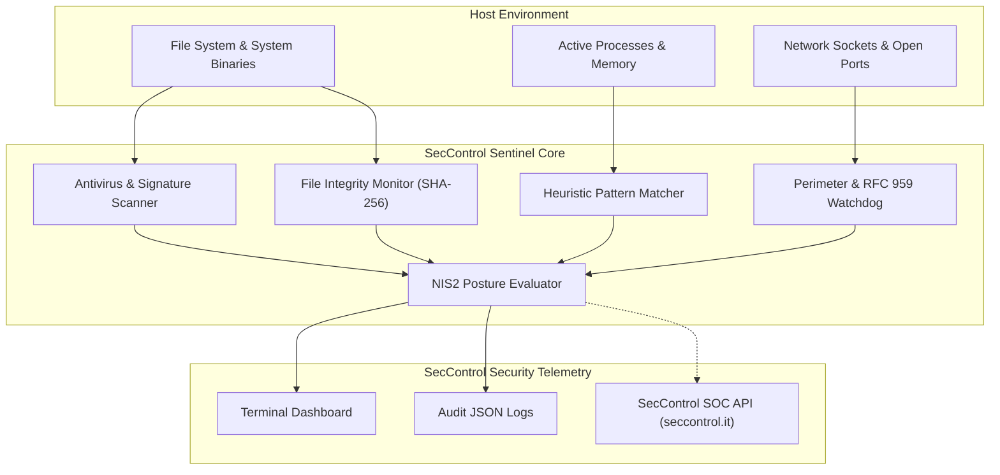

<p align="center">
  
</p>

# 🛡️ SecControl Sentinel

[](https://github.com/seccontrol/seccontrol-sentinel/actions)
[](https://www.python.org/)
[](https://opensource.org/licenses/Apache-2.0)
[](https://seccontrol.it)
[](https://seccontrol.it)

**SecControl Sentinel** is a lightweight, high-performance, open-source endpoint detection, behavioral antivirus, and perimeter monitoring watchdog (EDR / EASM) designed for Linux, Windows, and macOS enterprise environments.

Developed by **[SecControl SOC & Threat Intelligence](https://seccontrol.it)**, Sentinel bridges the gap between active host protection, real-time file integrity monitoring (FIM), and external perimeter exposure auditing (detecting unencrypted RFC 959 FTP 21, Telnet, and DNS spoofing risks), providing turnkey compliance with the European **NIS2 Directive (D.Lgs. 138/2024)**.

---

## ⚡ Key Capabilities

### 1. 🦠 Behavioral Antivirus & Malware Engine
* **Multi-Threaded Signature Scanner**: Instant verification of SHA-256 and MD5 hashes against known trojans, ransomware binaries, and cryptocurrency miners.
* **Heuristic Pattern Matcher**: Detects obfuscated webshells (`eval(base64_decode)`, Cobalt Strike stagers, reverse shell one-liners, PowerShell unconstrained execution).
* **Ransomware Burst Detection**: Monitors rapid mass file entropy shifts and unauthorized directory traversal typical of lockfile campaigns.

### 2. 👁️ Real-Time File Integrity Monitor (FIM)
* Cryptographic baseline hashing of critical system directories (`/etc/`, `/usr/bin/`, `/var/www/`, `C:\Windows\System32\`).
* Real-time alerting upon unauthorized file drops, binary modifications, or privilege elevation attempts.

### 3. 🌐 Perimeter & Exposure Watchdog (EASM)
* **RFC 959 Cleartext FTP Detector**: Alerts immediately if port 21/TCP is listening without TLS enforcement, preventing unencrypted document and credential exposure.
* **Insecure Service Sentinel**: Flags open Telnet (23), legacy unencrypted SMTP (25), and directly exposed database/RDP ports.
* **DNS Cyber Hygiene Checker**: Evaluates authoritative domain records for SPF (`RFC 7208`) and DMARC (`RFC 7489`) enforcement to stop Business Email Compromise (BEC) and spoofing.

### 4. 📜 NIS2 & Cyber Hygiene Telemetry Exporter
* Generates audit-ready Markdown and JSON telemetry maps directly aligned with **Art. 21 of D.Lgs. 138/2024** (Italian NIS2 transposition).
* Evaluates host posture score (Grado A, B, C, D) and outputs remediation playbooks for sysadmins and DevOps engineers.

---

## 🚀 Quick Start

### Installation

```bash
# Clone the repository
git clone https://github.com/seccontrol/seccontrol-sentinel.git
cd seccontrol-sentinel

# Install dependencies and package
pip install -r requirements.txt
pip install -e .
```

---

## 🛠️ Command-Line Usage

SecControl Sentinel provides a clean, interactive CLI powered by rich formatting:

### 1. Full Malware & Antivirus Scan
Scan any directory or file tree for suspicious indicators, webshells, and known malicious hashes:
```bash
seccontrol-sentinel scan /var/www/html
```

### 2. Perimeter & Listening Port Audit
Audit local interfaces for insecure cleartext protocols (e.g. RFC 959 cleartext FTP, Telnet) and evaluate perimetric risk:
```bash
seccontrol-sentinel audit-perimeter
```

### 3. Real-Time File Integrity Monitor (FIM)
Create a cryptographic baseline and watch for modifications in real-time:
```bash
seccontrol-sentinel monitor --path /etc --interval 5
```

### 4. NIS2 Compliance Report Generation
Evaluate system cyber hygiene and produce a compliance report:
```bash
seccontrol-sentinel report-nis2 --domain company.it --output nis2_audit.json
```

---

## 🏗️ Architecture



---

## 🔒 Security & Responsible Disclosure

SecControl Sentinel is maintained by the **SecControl SOC & Threat Intelligence Unit**.
If you discover a security vulnerability or wish to report indicators of compromise (IoC), please consult our [Security Policy](SECURITY.md) or contact us directly at:
📧 **assistenza@seccontrol.it** 

---

## 📄 License

Licensed under the **Apache License, Version 2.0**. See [LICENSE](LICENSE) for details.
Copyright © 2026 [SecControl Italia](https://seccontrol.it). All rights reserved.
